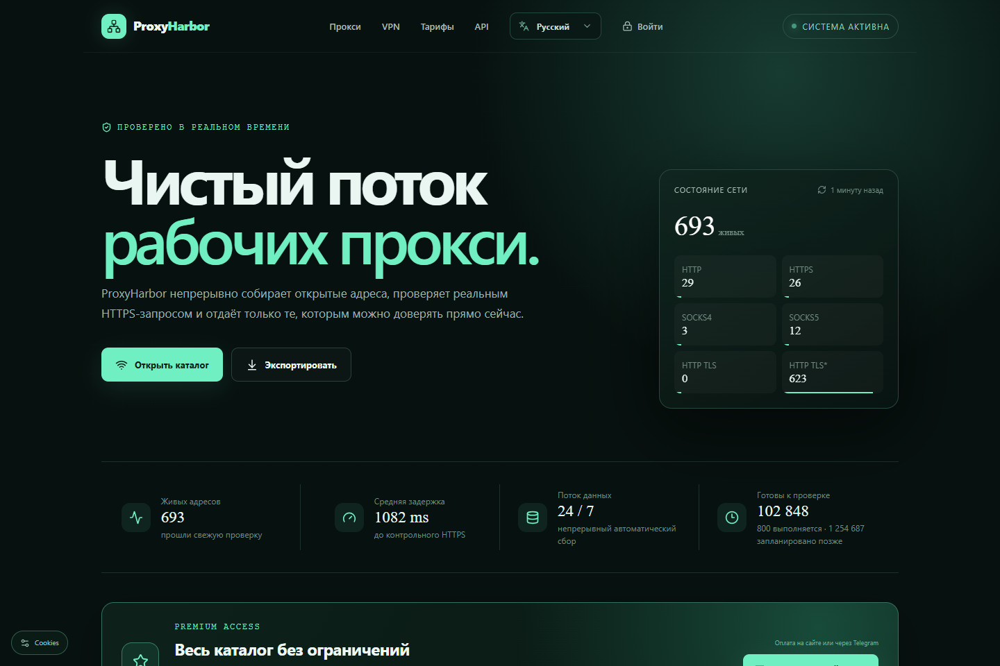
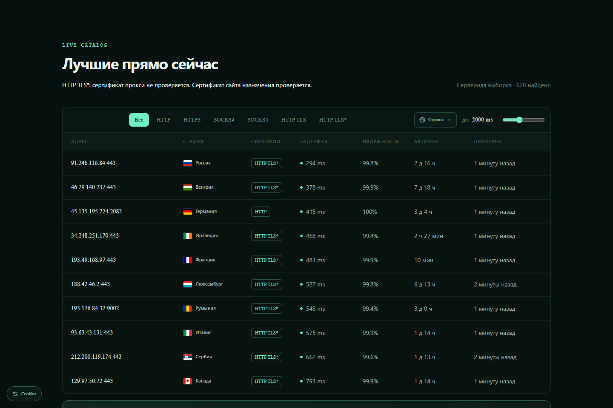
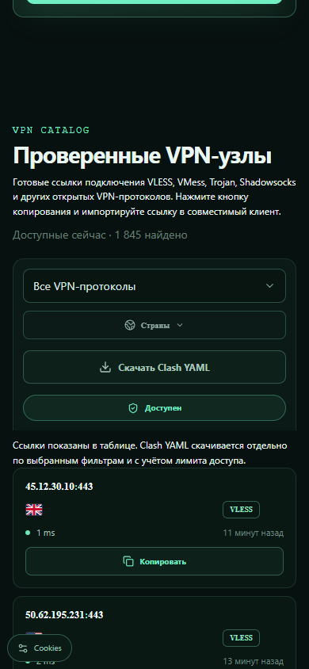

# ProxyHarbor

ProxyHarbor собирает публичные прокси и VPN-конфигурации, регулярно проверяет их доступность и выдаёт свежие результаты через веб-каталог и REST API. Сервис можно развернуть на своём сервере.

[Открыть ProxyHarbor](https://proxy.blagodaty.ru/) · [Быстрый запуск](#быстрый-запуск) · [Примеры API](#примеры-api) · [Документация](docs/README.md)



## Что можно делать

| Задача | Как выполнить |
| --- | --- |
| Найти прокси | Откройте [каталог прокси](https://proxy.blagodaty.ru/#catalog). Подберите протокол, страны и допустимую задержку. В таблице видны время последней проверки и доля успешных проверок. |
| Выгрузить прокси | Используйте экспорт на сайте или API. Доступны TXT, CSV, JSON и XML. |
| Импортировать VPN-конфигурацию | Откройте [каталог VPN](https://proxy.blagodaty.ru/#vpn-catalog). Скопируйте ссылку подключения в совместимый клиент или скачайте Clash YAML по выбранным фильтрам. |
| Управлять своим экземпляром | Подключайте источники и узлы проверки, следите за очередью и резервными копиями в панели администратора. |

### Каталог прокси



### Каталог VPN на телефоне



## Как работает проверка

1. Сборщики загружают включённые источники, разбирают форматы и сохраняют кандидатов в PostgreSQL.
2. Прокси проверяются контрольным HTTPS-запросом с учётом транспорта. Основной сервер может распределять партии между внешними агентами.
3. Для поддерживаемых VPN-узлов сервис проверяет доступность TCP endpoint и сохраняет опубликованные конфигурации. Подключение в клиенте зависит также от протокола, настроек и сети пользователя.
4. В публичную выдачу попадают результаты с достаточно свежей успешной проверкой. Адрес может стать недоступным между проверкой и подключением.

Веб-интерфейс использует React и TypeScript, API и фоновые службы работают на ASP.NET Core. Схемы компонентов и очередей описаны в [архитектуре](docs/ARCHITECTURE.md). Риски использования публичных прокси описаны в [политике безопасности](SECURITY.md).

## Примеры API

Запросы ниже можно выполнить на публичном экземпляре без ключа. В Windows PowerShell используйте `curl.exe`. Для своего экземпляра замените адрес на `http://localhost:8080`.

### Найти SOCKS5-прокси с задержкой до 1500 мс

```bash
curl -fsS 'https://proxy.blagodaty.ru/api/v1/proxies?protocol=Socks5&maxLatencyMs=1500&pageSize=10'
```

В ответе `items` содержит прокси с адресом, задержкой и временем последней проверки. `total` показывает размер выборки, а `accessible` — сколько результатов доступно с текущим уровнем доступа.

### Сохранить SOCKS5-прокси в текстовый файл

```bash
curl -fsS 'https://proxy.blagodaty.ru/api/v1/export/txt?protocol=Socks5&limit=10' -o proxies.txt
```

В `proxies.txt` каждый URL занимает отдельную строку. Для метаданных используйте `/api/v1/export/json` или `/api/v1/export/csv`. Бесплатный экспорт доступен раз в 10 минут. При ответе HTTP 429 повторите запрос после интервала из заголовка `Retry-After`.

### Получить VPN-конфигурации

```bash
curl -fsS 'https://proxy.blagodaty.ru/api/v1/vpn?pageSize=10'
```

В `items[].connectionUri` находится готовая ссылка подключения. Для выгрузки Clash YAML используйте `/api/v1/vpn/export/clash`. Доступность фильтров, правила бесплатной выдачи и курсоры описаны в [справочнике API](docs/API.md).

## Быстрый запуск

Понадобятся Git, Docker с Compose v2 и доступ контейнеров к внешним HTTPS-источникам. Для стандартных лимитов выделите машине минимум 4 ГБ оперативной памяти.

```bash
git clone https://github.com/Xsenus/ProxyHarbor.git
cd ProxyHarbor
cp .env.example .env
```

В PowerShell вместо `cp` можно выполнить `Copy-Item .env.example .env`.

Откройте `.env` и замените `POSTGRES_PASSWORD`, `ADMIN_PASSWORD`, `ADMIN_API_KEY` и `BACKUP_ENCRYPTION_KEY` независимыми секретами. У администратора должен быть пароль из 24–256 символов с заглавной и строчной буквами, цифрой и спецсимволом. Для локального запуска без Telegram установите `BACKUP_ENABLED=false`. Остальные параметры описаны в [справочнике конфигурации](docs/CONFIGURATION.md).

```bash
docker compose config --quiet
docker compose up -d --build
docker compose ps
curl -fsS http://localhost:8080/health/ready
```

Когда readiness отвечает HTTP 200, откройте [локальный сайт](http://localhost:8080/) или [OpenAPI](http://localhost:8080/openapi/v1.json). Войдите с `ADMIN_USERNAME` и `ADMIN_PASSWORD` из `.env`. Публичный каталог начнёт заполняться после первого сбора и проверки.

## Развёртывание и обслуживание

| Задача | Инструкция |
| --- | --- |
| Настроить домен, HTTPS и обновления | [Развёртывание и откат](docs/DEPLOYMENT.md) |
| Подключить ленту и проверить результат | [Источники и контроль сбора](docs/SOURCES.md) |
| Подключить VPS или вывести старый узел из работы | [Распределённые чекеры](docs/DISTRIBUTED_CHECKERS.md) |
| Настроить бэкап, подтверждать доставку частей и восстановить базу | [Бэкап и восстановление](docs/BACKUP_RESTORE.md) |
| Разобрать предупреждение или просадку производительности | [Мониторинг](docs/MONITORING.md) · [Производительность](docs/PERFORMANCE.md) |

## Разработка

Код API и фоновых компонентов находится в `src/`, интерфейс — в `src/proxyharbor-web/`, тесты .NET — в `tests/`, эксплуатационные и проверочные скрипты — в `tools/`.

[Как внести изменения и запустить проверки](CONTRIBUTING.md) · [Все руководства](docs/README.md) · [История изменений](CHANGELOG.md) · [Поддержка](SUPPORT.md)

Код проекта распространяется по [лицензии MIT](LICENSE).
